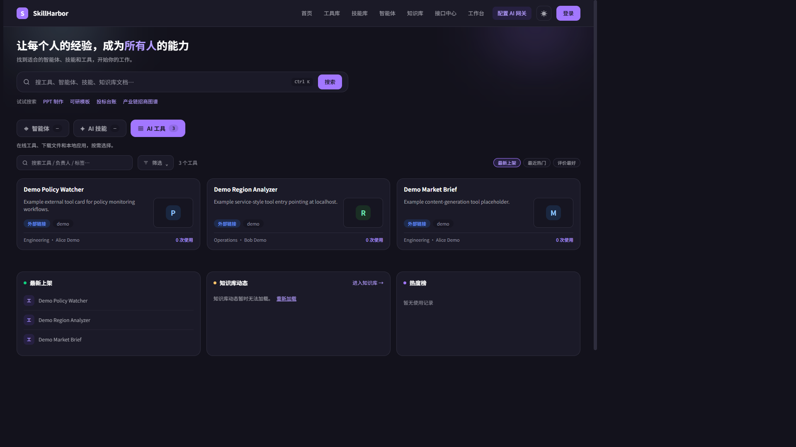
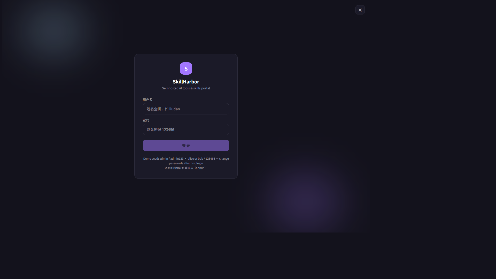
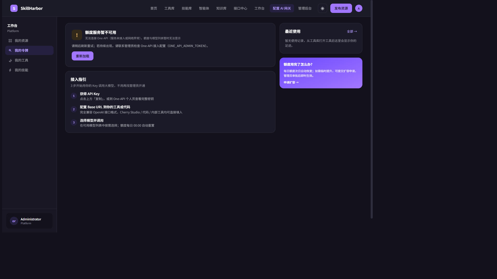

# SkillHarbor

自托管的 **AI 工具与技能门户**：工具库、技能中心对接、员工工作台（API 令牌 / 额度）、以及管理后台（审核、发布、统计、用户）。

- 前端：React 18 + TypeScript + Vite + Tailwind（HashRouter）
- 后端：零依赖 Node.js（`server.cjs`，Node ≥ 18），JSON 文件持久化
- 部署：Docker（`node:20-alpine`），业务数据落独立数据卷

## 界面预览

**首页 · 工具库**



**登录页**



**工作台 · 我的令牌**



## 快速开始

```bash
npm install
node server.cjs 8900   # 后端 API（首次启动会播种演示账号）
npm run dev            # Vite 开发服务器（/api 已代理到 127.0.0.1:8900）
```

生产模式（托管 `dist/`）：

```bash
npm run build
npm start              # node server.cjs（默认端口 8900）
```

可复制 [`.env.example`](.env.example)，按需配置上游地址与令牌。

### 演示账号（首次启动）

当 `DATA_DIR` 为空时，从 `server-seed-users.json` 播种：

| 用户 | 密码 | 角色 |
|------|------|------|
| `admin` | `admin123` | 管理员 |
| `alice` / `bob` | `123456` | 普通用户 |

**首次登录后请立即修改密码。**

## 功能概览

- 工具库：上传 → 解析 → 审核 → 发布 / 部署
- 技能包：对接可选的 Skill Gateway
- 工作台：个人模型令牌与额度（经 One-API 或兼容网关）
- 知识库浏览器（可选 MxsDoc 桥接）
- 管理后台：统计、审核中心、服务运维、网关日志、系统设置

## 架构

```text
浏览器（Vite / dist）
   └─ /api/*  →  server.cjs
                   ├─ DATA_DIR 下的 JSON 存储
                   ├─ 可选 One-API 代理
                   ├─ 可选 Skill Gateway 代理
                   └─ 可选 Docker 通道（服务型工具）
```

## Docker

```bash
npm run build
docker build -t skillharbor:local .
docker run --rm -p 8900:8100 -v skillharbor-data:/app/data skillharbor:local
```

若需把用户上传内容与门户跨源隔离，可参考 `files-nginx.conf` 中的独立 nginx 源配置。

## 常用脚本

| 命令 | 说明 |
|------|------|
| `npm run typecheck` | TypeScript 类型检查 |
| `npm test` | 前端 Vitest |
| `npm run test:server` | 后端 `scripts/test-*.cjs` |

## 文档

使用与运营说明见 [`docs/`](docs/)。技能示例见 [`skills/`](skills/)。

## 安全

请阅读 [SECURITY.md](SECURITY.md)。不要提交 `data/`、`.env` 或真实凭据；运行时密钥应放在数据卷或环境变量中。

## 许可证

[MIT](LICENSE) © SkillHarbor Contributors
